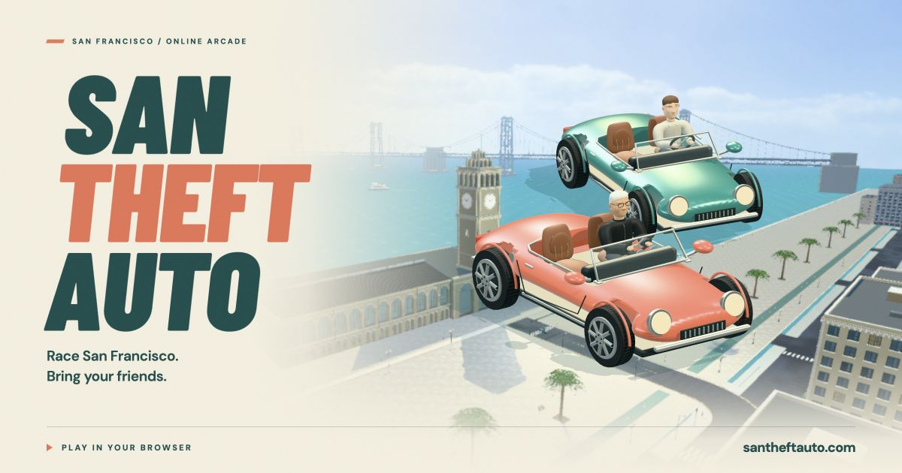

# San Theft Auto

**[Play at santheftauto.com](https://santheftauto.com)** ↗️

A browser racing game built around San Francisco: its neighborhoods, steep
streets, recognizable landmarks, and a few exaggerated hill flights. Race solo,
share a room with friends, or take a slower drive through the city.



We are building San Francisco incrementally, one map and neighborhood at a time.
Racing is the playable foundation for the project’s
[longer-term open-world direction](#direction-and-roadmap).

## Play today

**City Loop is the only enabled course.** It runs from Union Square up Powell,
through Chinatown, and down to the Ferry Building. Street connections and
landmarks draw from the real city; distances, hills, and handling are adapted
for an arcade racer.

| Mode | What you can do |
| --- | --- |
| Single player | Choose a driver and car, race the course, and improve your local best time. |
| Multiplayer | Create a private room for **2–8 players**, share its URL, and race friends on the same map. |
| Free drive | Explore Union Square’s streets and terraces, find five postcards, and continue toward the bay without a timer. |
| Watch a Run | Follow an automatic drive or jump to scenic views of Union Square, the Westin, Chinatown, and the waterfront. |

Multiplayer shows everyone’s driver, car, and sponsor choices live. Each player
confirms readiness; the host starts the current room when everyone is ready.
The server controls driving, checkpoints, and finish times. Cars share the map
without player-to-player collisions, and the results show finishing order and
DNFs. The host can start a rematch in the same room.

The race collection also shows six **Coming soon** routes: VC Circle, Cerebral
Valley, Golden Gate Surfride, Lands End, Presidio Run, and Golden Gate → Hawk Hill.
Their experimental code and assets are in the repository, but the current game
does not launch them. See the [route plans](docs/city-races-prd.md) and
[Cerebral Valley rebuild notes](docs/cerebral-valley-rebuild.md).

Basic controls: **W / Up** to accelerate, **A/D or Left/Right** to steer,
**S / Down** to brake or reverse, **Shift** to boost, **Space** to drift, and
**Q** to recover. Touch and standard
gamepads are supported. The [game guide](docs/game-guide.md) covers flight,
exploration, graphics options, and scenic stops; the
[multiplayer guide](docs/multiplayer.md) covers rooms, reconnects, and results.

## Direction and roadmap

Racing gives each neighborhood a useful first test: roads must connect, turns
must read clearly, hills must feel good to drive, and landmarks must hold up
both at street level and at speed. Solo and shared races make those maps
playable while we improve their geometry, art, performance, and handling.

The immediate work is to strengthen City Loop and develop the experimental
routes into coherent, playable neighborhoods. More complete maps and connections
between them provide the groundwork for a fuller San Francisco.

The longer-term goal is a **Grand Theft Auto–style open-world game set in
San Francisco**. Broader open-world systems are a future aspiration, dependent
on building out enough of the city. The available modes above describe the
current racing release.

## Run locally

Use **Node 22.21.0 or later in the 22.x line** and npm. The repository pins
Node **22.23.3** in [.node-version](.node-version). Exported game assets are
included; Blender is needed only when regenerating them.

```sh
npm ci
npm run dev
```

Open the URL printed by Vite, normally [localhost:5173](http://localhost:5173).
The development server includes the room API, so **local multiplayer works with
this same command**. No Cloudflare account is needed. Test with separate browser
tabs or sessions. For another device on the same Wi-Fi, open Vite’s printed
Network URL before creating the room; a localhost invite works only on its
own computer.

To run the built game with the included single-process Node room server:

```sh
VITE_POSTHOG_ENABLED=false npm run build
npm start
```

The default address is [localhost:3000](http://localhost:3000). `npm run preview`
serves the static build only and does **not** supply multiplayer rooms.

## Where things live

The game uses **TypeScript, Three.js, Vite, Web Audio, and a shared arcade driving
simulation**. The public deployment serves the site through Cloudflare Workers,
with one Durable Object per multiplayer room. The Node server supports local
development and an alternative hosting path.

| Area | Source |
| --- | --- |
| Game entry, camera, rendering, controls, and UI | [src/main.ts](src/main.ts), [src/style.css](src/style.css) |
| Shared driving rules and City Loop route | [src/driving.ts](src/driving.ts), [src/route.ts](src/route.ts), [src/playground.ts](src/playground.ts) |
| Multiplayer client, protocol, and motion | [src/multiplayer.ts](src/multiplayer.ts), [src/multiplayer-protocol.ts](src/multiplayer-protocol.ts), [src/room-interpolation.ts](src/room-interpolation.ts) |
| Authoritative rooms and hosting adapters | [server/](server/), [cloudflare/](cloudflare/) |
| City and landmark rendering | [src/city-loop.ts](src/city-loop.ts), [src/union-square.ts](src/union-square.ts), [src/waterfront.ts](src/waterfront.ts) |
| Drivers, cars, and garage previews | [src/car.ts](src/car.ts), [src/racer-profile.ts](src/racer-profile.ts), [src/racer-showroom.ts](src/racer-showroom.ts) |
| Editable models, generators, and shipped assets | [art/source/](art/source/), [tools/blender/](tools/blender/), [public/assets/](public/assets/) |

## Contributing

Contributions are welcome, especially city and landmark improvements, clearer
onboarding, driving feel, accessibility, multiplayer reliability, and rendering
performance. Start with a focused change that can be reviewed and played on its
own. For a new neighborhood or major system, describe the intended scope in an
issue before building it.

Unless explicitly stated otherwise, code contributions intentionally submitted
for inclusion are under Apache 2.0, as described in section 5 of [LICENSE](LICENSE).
Only submit material you have the right to contribute, and retain third-party
notices. Asset contributions must identify their source and applicable permissions.

- **City and art:** use the [Blender pipeline](BLENDER_ASSETS.md), retain editable
  sources and regeneration steps, and record geographic references and asset
  provenance. Include before/after views and note changes to asset size or detail.
- **Gameplay and multiplayer:** keep client and server behavior consistent.
  Include relevant regression checks; for room changes, exercise host and guest
  in independent sessions through selection, start, finish, and rematch.
- **UI and performance:** show the affected flow, viewport, and browser. Compare
  rendering measurements in the same scene so visual improvements remain playable.
- **Pull requests:** explain the problem, the resulting behavior, and what you
  verified. Keep generated assets and their source changes together when needed.

Run checks relevant to your change:

```sh
npm test
npm run test:multiplayer
npm run build
```

Cloudflare changes also use `npm run test:cloudflare` and the
[local Worker workflow](docs/cloudflare.md#local-build-and-verification).
Waterfront asset changes use `node tools/validate-waterfront.mjs`.
The [game guide](docs/game-guide.md#verify) describes existing coverage and
read-only browser diagnostics. Publishing is separate from local development;
see the [Cloudflare runbook](docs/cloudflare.md) or the
[Node hosting runbook](docs/launch.md).

## Usage analytics

**Tracking is off without your own `VITE_POSTHOG_KEY`; no project key is bundled
in the source.** Production builds with a key enable tracking unless
`VITE_POSTHOG_ENABLED=false`; development also requires
`VITE_POSTHOG_ENABLED=true`. For Cloudflare, copy [.env.example](.env.example) to
ignored `.env.cloudflare.local` and set your key there, or supply build-time CI
variables. Only `build:cloudflare` and `deploy:cloudflare` load that deployment
file. The [analytics guide](docs/analytics.md) covers configuration, recorded
events, nickname/lineup data, and privacy handling. Public ingestion keys remain
visible in configured browser bundles.

## Assets and licensing

The project combines original Blender models and generated geometry with
third-party materials, scenery, geographic references, and brand artwork.
Playable cars and drivers use the same Blender kit in selection and racing.
The seven cartoon drivers come from approved image concepts and textured 3D
sculpts, optimized in Blender; dense source studies stay outside the deployed
game. Playing or building the game does not require an image-generation or
3D-generation API key. The current characters are portraits and seated racers. Full walking
bodies and animation rigs are future work for the broader city game.
Sources and attribution are recorded in [asset credits](public/assets/CREDITS.md),
[sponsor artwork sources](public/assets/sponsors/SOURCES.md), and the
[Blender pipeline](BLENDER_ASSETS.md).

**Original software source code, scripts, configuration, and accompanying text
documentation are licensed under the [Apache License 2.0](LICENSE)**, except for
separately identified third-party material and the exclusions below.
Copyright 2026 Nader Khalil. See [NOTICE](NOTICE).

Apache 2.0 permits use, modification, and redistribution, including commercial
and closed-source reuse, subject to its conditions. It includes warranty and
liability disclaimers, an express contributor patent license with a patent
litigation termination provision, and no general grant of trademark rights.

The code license does **not** relicense these materials, wherever they appear:

- **Game assets:** models, textures, images, audio files, character artwork, and
  other separately stored creative assets, including those in `art/`,
  `public/assets/`, and `public/social/`. To the extent the project owner holds
  rights in original assets, those rights are reserved unless separate terms
  expressly grant permission. Third-party and public-domain assets retain their
  existing terms; this reservation does not restrict rights granted by those terms.
- **Geographic data:** OpenStreetMap-derived data remains subject to the
  [Open Database License 1.0](https://opendatacommons.org/licenses/odbl/1-0/),
  including data embedded in [src/cerebral-geography.ts](src/cerebral-geography.ts).
  Other geographic sources retain their applicable terms. See the
  [Cerebral Valley source notes](public/assets/cerebral-valley/SOURCE.md).
- **Third-party software and materials:** dependencies, the bundled Draco decoder,
  and other third-party content retain their own licenses and notices.
- **Names, logos, and likenesses:** no permission to use third-party branding or
  protected personality rights is granted by the code license. See the
  [sponsor artwork sources](public/assets/sponsors/SOURCES.md) and
  [character credits](public/assets/CREDITS.md#playable-characters-and-surfaces).

These exclusions identify separate material; they do not add restrictions to
the code licensed under Apache 2.0. A code license does not clear third-party
rights or guarantee protection from legal claims.

## More documentation

- [Detailed game guide and historical checkpoints](docs/game-guide.md)
- [Multiplayer behavior and local setup](docs/multiplayer.md)
- [Multiplayer flow and acceptance criteria](docs/multiplayer-flow-prd.md)
- [City race plans](docs/city-races-prd.md)
- [Cerebral Valley development](docs/cerebral-valley-rebuild.md)
- [Map quality audit](docs/map-quality-audit.md)
- [Blender assets and rebuilding](BLENDER_ASSETS.md)
