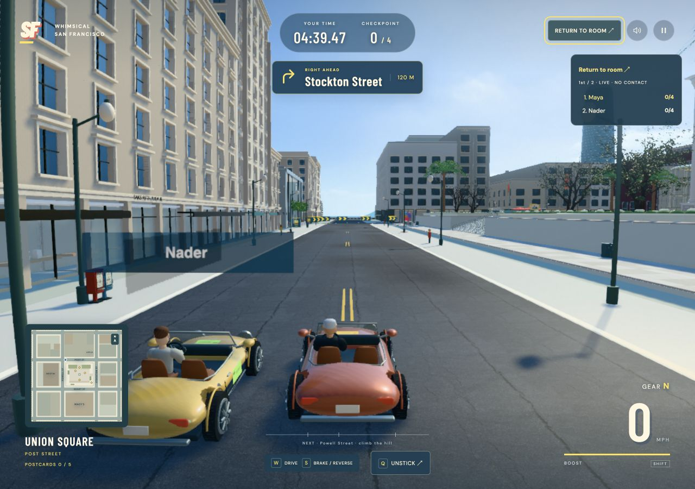
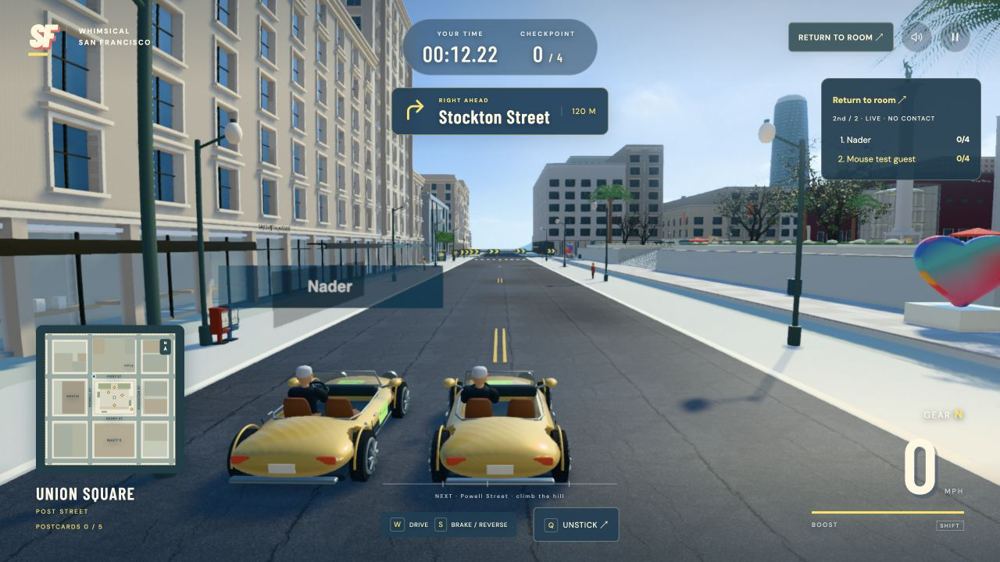

# Multiplayer verification checkpoint

8 October 2026 · Local working-tree verification

The implemented flow is documented in the [multiplayer specification](../../../multiplayer-flow-prd.md). Driver, garage and scene assets are preserved; this checkpoint covers room entry, shared racing and results.

## Automated checks

| Check | Result |
| --- | --- |
| Gameplay suite | 146 tests passed |
| Multiplayer room and HTTP suite | 22 tests passed |
| Production build | Passed |

## Browser checks

Two local browser sessions verified:

- Room creation and joining through the invitation, with live player selections.
- Ready confirmation, host-controlled Start, a shared countdown and the same starting grid.
- Separate driving inputs, visible opponent movement and rank updates.
- Identity restoration after hot reload.
- A departed racer retained in the round as **DNF · Left race**.
- Natural race-deadline completion, with both entrants retained in final results and **No finisher this race** when neither finished.
- **Race again** preserved the invitation, driver and car; readiness reset to **0/1**. **Last results** retained departed Maya and the host with their DNF reasons. A ready host alone still had Start disabled.
- **Single player → Driver → Car → Start** reached the actual solo countdown without nickname or room prompts.

The browser run above verifies the shared race and all-DNF result path. It does not by itself verify a manually driven winning finish; finish timing and result ordering also have automated coverage.

## Remaining validation

- Public HTTPS deployment and racing between devices on different internet connections have not been verified.
- Eight real devices, degraded-network performance and the specification's latency targets have not been verified.

Local browser sessions and passing tests do not establish internet or device-load readiness.

## Start button mouse-click regression

The initial browser check used keyboard activation and missed a pointer bug: comparing generated HTML against browser-normalized `innerHTML` replaced room controls on every 50 ms snapshot. A mouse press could lose its button before release. The renderer now remembers the last supplied markup and retains unchanged controls.

After rebuilding, the enabled Start button remained the same connected DOM node across 500 ms of live snapshots. An actual mouse click started the two-player countdown and entered the race in both sessions. The production build and whitespace check passed. The running local server serves the fix after refreshing the page; it was not restarted, preserving existing rooms.

